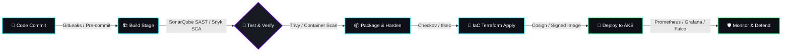

<div align="center">

<!-- Header Banner -->


<!-- Dynamic Typing Subtitle -->
<a href="https://github.com/AjavinashAj">
  
</a>

<br/>

<!-- Real-Time Status Badges -->
<p align="center">
  <a href="https://linkedin.com/in/avinashkumar1345" target="_blank">
    
  </a>
  <a href="https://github.com/AjavinashAj">
    
  </a>
  <a href="https://github.com/AjavinashAj">
    
  </a>
  <a href="https://komarev.com/ghpvc/?username=AjavinashAj&label=PROFILE+VIEWS&style=for-the-badge&color=00ff87" target="_blank">
    
  </a>
</p>

<!-- Quick Navigation Anchors -->
<p align="center">
  <a href="#-about-me"><b>About Me</b></a> •
  <a href="#-devsecops-pipeline-architecture"><b>DevSecOps Pipeline</b></a> •
  <a href="#-technical-arsenal"><b>Tech Arsenal</b></a> •
  <a href="#-featured-projects"><b>Featured Projects</b></a> •
  <a href="#-engineering-philosophy"><b>Core Principles</b></a> •
  <a href="#-github-metrics--telemetry"><b>Metrics & Telemetry</b></a> •
  <a href="#-connect-with-me"><b>Connect</b></a>
</p>

---

</div>

## 👤 About Me

```yaml
apiVersion: universe/v1
kind: DevSecOpsEngineer
metadata:
  name: "Avinash Kumar"
  experience: "3+ Years in Enterprise DevOps & DevSecOps"
  reputation: "Battle-Tested Production Engineer 🛡️"
spec:
  cloud_ecosystem: ["Microsoft Azure", "Multi-Cloud Architectures"]
  iac_standards: ["Terraform", "Terragrunt", "Ansible", "Bash/Python"]
  containers_orchestration: ["Docker", "Kubernetes (AKS)", "Helm", "Microservices"]
  security_posture: ["Zero-Trust", "Shift-Left", "SAST/DAST/SCA", "Container Hardening"]
  ci_cd_engines: ["GitHub Actions", "Azure DevOps Pipelines", "Jenkins", "GitOps"]
  observability: ["Prometheus", "Grafana", "Azure Monitor", "Alertmanager"]
  mission: "Eliminating deployment friction while embedding unbreachable security gates into every commit."
```

👋 **Hello, World! I'm Avinash Kumar** — a passionate **DevSecOps & Cloud Engineer** with over 3 years of hands-on experience designing, automating, and securing cloud-native infrastructures.

- 🛡️ **Shift-Left Security Advocate**: I inject automated security gates (*SAST, SCA, Secret Scanning, Container Auditing, and IaC Hardening*) into CI/CD pipelines before code ever reaches production.
- ☁️ **Cloud & Infrastructure as Code (IaC)**: Architecting highly available, modular Azure environments using **Terraform**, automated networking (VNet, NSG, Private Endpoints), and zero-drift state management.
- 🚀 **Continuous Delivery & Automation**: Building blazing-fast, declarative CI/CD pipelines using **GitHub Actions**, **Azure DevOps**, and **Jenkins** to take features from pull request to production with zero downtime.
- 🐳 **Containerization & Orchestration**: Hardening Docker images with multi-stage builds and managing resilient workloads on **Kubernetes (AKS)** using Helm and GitOps best practices.

---

## 🛡️ DevSecOps Pipeline Architecture

> *"Security isn't a gatekeeper at the end of the line — it is the steel foundation running through every stage of software delivery."*



### 🔒 Enterprise Security Gates Matrix

| Pipeline Phase | Primary Objective | Weapons & Tools Deployed | Security Impact |
| :--- | :--- | :--- | :--- |
| **01. Source & Commit** | Prevent Secrets & Credential Leakage | `GitLeaks`, `Pre-commit Hooks`, `Git` | Zero accidental API keys or passwords in Git history |
| **02. Continuous Integration** | Static Code Analysis & Dependency Check | `SonarQube (SAST)`, `Snyk (SCA)`, `OWASP` | Identifies CVEs and code smells at the PR stage |
| **03. Artifact Packaging** | Vulnerability-Free Container Images | `Docker Multi-stage`, `Trivy`, `Alpine/Distroless` | Eliminates image bloat, root privileges & CVEs |
| **04. Infrastructure as Code** | Compliance & Misconfiguration Auditing | `Terraform`, `tfsec`, `Checkov`, `Infracost` | Prevents exposed ports, open S3/Blob storage, and cost surprises |
| **05. Artifact Verification** | Cryptographic Supply Chain Security | `Cosign`, `Docker Content Trust` | Ensures only trusted, signed binaries run on Kubernetes |
| **06. Orchestration & GitOps** | Resilient Zero-Downtime Deployment | `Azure Kubernetes Service (AKS)`, `Helm`, `ArgoCD` | Declarative rollouts, self-healing pods, network isolation |
| **07. Telemetry & Runtime** | Proactive Observability & Threat Detection | `Prometheus`, `Grafana`, `Azure Monitor`, `Falco` | Real-time alerts, SLA monitoring, and runtime intrusion detection |

---

## 🛠️ Technical Arsenal

<div align="center">
  
</div>

<br/>

### ☁️ Cloud & Container Orchestration
<p>
  
  
  
  
  
</p>

### 📜 Infrastructure as Code (IaC) & Automation
<p>
  
  
  
  
  
</p>

### 🚀 CI/CD & GitOps Automation
<p>
  
  
  
  
  
</p>

### 🛡️ DevSecOps, AppSec & Cloud Security
<p>
  
  
  
  
  
  
</p>

### 📊 Observability, Telemetry & Logging
<p>
  
  
  
  
</p>

---

## 🚀 Featured Projects & Production Architectures

<table>
  <tr>
    <td width="50%" valign="top">
      <h3>🏗️ <a href="https://github.com/AjavinashAj/terraform-azure-modular-infrastructure">Terraform Azure Modular Infrastructure</a></h3>
      <p><b>Production-Grade Enterprise Cloud Foundation</b></p>
      <ul>
        <li>Architected modular, reusable Terraform blueprints for Azure Hub-and-Spoke networks.</li>
        <li>Implemented Azure VNets, Subnets, Network Security Groups (NSGs), and Private Endpoints.</li>
        <li>Zero-Trust state isolation utilizing Azure Blob Storage with remote state locking.</li>
        <li>CIS benchmark compliance integration with automated <code>tfsec</code> scanning.</li>
      </ul>
      <p>
        
        
        
      </p>
    </td>
    <td width="50%" valign="top">
      <h3>⚡ <a href="https://github.com/AjavinashAj/Azure_Terraform_DevOps">Azure DevOps CI/CD Automation Engine</a></h3>
      <p><b>End-to-End Automated Cloud Provisioning Pipeline</b></p>
      <ul>
        <li>Built resilient multi-stage CI/CD pipelines deploying infrastructure across Dev, Stage, and Prod.</li>
        <li>Integrated automated validation, <code>terraform plan</code> diff generation, and manual security gates.</li>
        <li>Integrated Azure Key Vault for seamless, zero-hardcoded secret injection during deployments.</li>
        <li>Self-hosted Azure DevOps agent configuration on hardened Linux virtual machines.</li>
      </ul>
      <p>
        
        
        
      </p>
    </td>
  </tr>
  <tr>
    <td width="50%" valign="top">
      <h3>🛡️ <a href="https://github.com/AjavinashAj/Avinash_DevOps">Enterprise DevSecOps & Container Security</a></h3>
      <p><b>Multi-Stage Hardened Microservices Pipeline</b></p>
      <ul>
        <li>Developed production Docker images with distroless base images, reducing attack surface by 70%.</li>
        <li>Automated container vulnerability scanning using <b>Trivy</b> with build break thresholds for Critical CVEs.</li>
        <li>Implemented <b>GitLeaks</b> pre-commit and pipeline scans to prevent secret leaks across repos.</li>
        <li>Configured SonarQube quality gates ensuring code reliability, security rating A, and high test coverage.</li>
      </ul>
      <p>
        
        
        
      </p>
    </td>
    <td width="50%" valign="top">
      <h3>☸️ <a href="https://github.com/AjavinashAj/Avinash_DevOps">Kubernetes (AKS) Cluster & GitOps Delivery</a></h3>
      <p><b>Scalable High-Availability Cloud Orchestration</b></p>
      <ul>
        <li>Configured multi-node Azure Kubernetes Service (AKS) with automated node scaling.</li>
        <li>Packaged microservices into customized <b>Helm Charts</b> with parameterized values for each environment.</li>
        <li>Enforced Kubernetes NetworkPolicies, Pod Security Standards, and RBAC least-privilege access.</li>
        <li>Deployed Nginx Ingress Controller with automated TLS termination via Cert-Manager and Let's Encrypt.</li>
      </ul>
      <p>
        
        
        
      </p>
    </td>
  </tr>
</table>

---

## ⚡ Engineering Philosophy

```
  +---------------------------------------------------------------------------------+
  |  "Amateurs defend systems at runtime. Masters design systems that cannot drift." |
  +---------------------------------------------------------------------------------+
```

- 🛡️ **Shift-Left Early & Uncompromisingly**: Security must be friction-free for developers. When security tools run inside pull requests with actionable feedback, bugs are fixed in minutes rather than weeks.
- 📜 **Infrastructure as Code (IaC) is Non-Negotiable**: No manual clicks in cloud consoles. If it's not codified, peer-reviewed, and versioned in Git, it does not exist in production.
- 🔄 **Immutable Infrastructure**: Servers and containers are disposable cattle, never pets. Immutable builds guarantee consistency between development, staging, and enterprise production.
- 📈 **Proactive Observability over Reactive Firefighting**: Metrics, distributed traces, and automated alerts empower engineering teams to prevent outages before users ever notice an anomaly.

---

## 📊 GitHub Metrics & Telemetry

<div align="center">

<table border="0">
  <tr>
    <td>
      <a href="https://github.com/AjavinashAj">
        
      </a>
    </td>
    <td>
      <a href="https://github.com/AjavinashAj">
        
      </a>
    </td>
  </tr>
</table>

<br/>

<a href="https://github.com/AjavinashAj">
  
</a>

</div>

---

## 📬 Connect With Me

<div align="center">

<p><b>Whether you want to discuss DevSecOps pipelines, Cloud Architecture, Kubernetes security, or collaborate on open-source projects — let's connect!</b></p>

<p align="center">
  <a href="https://www.linkedin.com/in/avinashkumar1345" target="_blank">
    
  </a>
  <a href="https://github.com/AjavinashAj" target="_blank">
    
  </a>
  <a href="https://www.linkedin.com/in/avinashkumar1345" target="_blank">
    
  </a>
</p>

<br/>

<!-- Footer Banner -->


<p align="center">
  <i>⚡ Engineered with passion for Zero-Trust Cloud & Bulletproof Pipelines • © Avinash Kumar ⚡</i>
</p>

</div>
