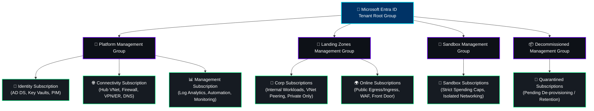
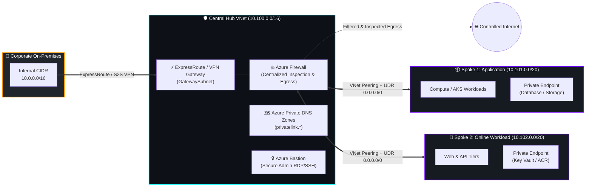
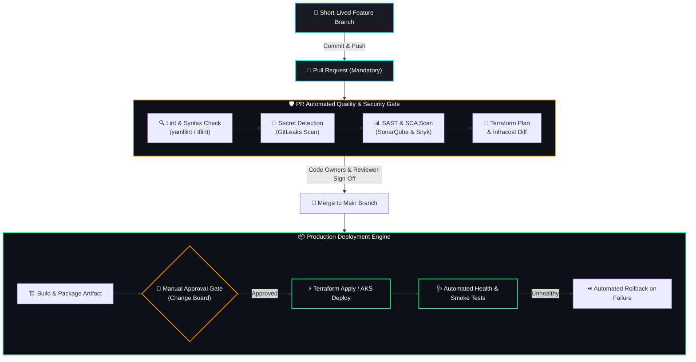
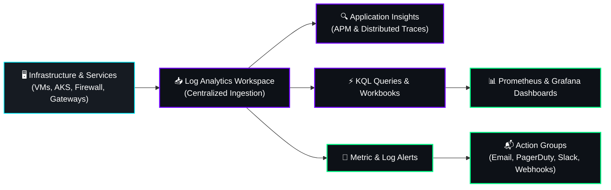

<div align="center">

<!-- Header Banner -->


<!-- Dynamic Animated Subtitle -->
<a href="https://github.com/AjavinashAj">
  
</a>

<br/>

<!-- Real-Time Status & Experience Badges -->
<p align="center">
  <a href="https://linkedin.com/in/avinashkumar1346" target="_blank">
    
  </a>
  <a href="https://github.com/AjavinashAj">
    
  </a>
  <a href="https://github.com/AjavinashAj">
    
  </a>
  <a href="https://komarev.com/ghpvc/?username=AjavinashAj&label=PROFILE+VISITS&style=for-the-badge&color=00ff87" target="_blank">
    
  </a>
</p>

<!-- Fast Navigation Jump Bar -->
<p align="center">
  <a href="#-enterprise-tenant-and-management-group-hierarchy"><b>Tenant Hierarchy</b></a> •
  <a href="#-hub-and-spoke-networking--zero-trust-architecture"><b>Hub & Spoke Network</b></a> •
  <a href="#-multi-layered-defense-in-depth-security"><b>Defense-in-Depth</b></a> •
  <a href="#-terraform-enterprise-landing-zone-automation"><b>Terraform Automation</b></a> •
  <a href="#-azure-devsecops-pipeline-engineering"><b>CI/CD Pipelines</b></a> •
  <a href="#-enterprise-cloud-migrations"><b>Cloud Migrations</b></a> •
  <a href="#-finops--cost-optimization"><b>FinOps</b></a> •
  <a href="#-high-availability-bcdr--resilience"><b>BCDR & HA</b></a> •
  <a href="#-observability--monitoring"><b>Observability</b></a> •
  <a href="#-featured-repositories"><b>Featured Projects</b></a> •
  <a href="#-connect-with-me"><b>Connect</b></a>
</p>

---

</div>

## 🏛️ Enterprise Tenant and Management Group Hierarchy

> Following the **Microsoft Cloud Adoption Framework (CAF)** methodology (`Strategy ➔ Plan ➔ Ready ➔ Adopt ➔ Govern ➔ Secure ➔ Manage`), I architect scalable subscription models that decouple platform governance from application workloads.



### 📋 Governance & Management Matrix

| Pillar | Architectural Implementation & Best Practices |
| :--- | :--- |
| **Tenant Root & Boundaries** | Centralized root under Microsoft Entra ID. No direct workload deployment at root level. Enforces global organizational guardrails. |
| **Subscription Archetypes** | Strict boundary separation between **Platform Subscriptions** (Identity, Connectivity, Management) and **Application Landing Zones** (Corp & Online). |
| **Azure Policy & Initiatives** | Hierarchical policy inheritance assigning **CIS Azure Benchmark**, **NIST SP 800-53**, and custom regulatory initiatives. Enforces tagging standards, allowed regions, and resource SKU restrictions. |
| **Policy Exemptions Lifecycle** | Zero informal overrides. Formal exemption process requiring business justification, risk sign-off, time-bound expiration dates, and automated re-audit. |
| **Enterprise RBAC & Identity** | Role-Based Access Control mapped to Entra ID security groups (no individual user assignments). Enforces **Privileged Identity Management (PIM)** with Just-In-Time (JIT) activations and mandatory MFA. |
| **Subscription Lifecycle** | Fully codified onboarding/offboarding workflow: automated baseline vNet peering, monitoring workspace linking, policy baseline application, and clean state de-provisioning. |

---

## 🌐 Hub and Spoke Networking & Zero-Trust Architecture

> Resilient network architecture engineered for **centralized traffic inspection**, **shared hybrid connectivity**, and **strictly controlled outbound egress**.



### 🛠️ Networking Engineering Competencies

- **IP Address Management (IPAM) & CIDR Sizing**: Strategic planning across global multi-region deployments. Comprehensive assessment to guarantee **zero CIDR overlaps** with on-premises corporate subnets.
- **VNet Peering with Gateway Transit**: Hub configured with `allow_gateway_transit = true`; Spokes configured with `use_remote_gateways = true`, avoiding costly redundant network gateways.
- **User Defined Routes (UDR)**: Route Tables applied to all Spoke subnets forcing `0.0.0.0/0` (Default Route) and inter-spoke traffic through the **Azure Firewall Private IP** as the next hop.
- **Private Link & Private DNS Zones**: Direct routing for PaaS services (Azure SQL, Storage, Key Vault, ACR) via **Private Endpoints**, eliminating public IPs and stopping DNS exfiltration.
- **Secure Egress & Ingress**: Layer 7 Application & Network Rule collections on Azure Firewall with Threat Intelligence filtering, SNAT/DNAT, and FQDN whitelisting.

---

## 🛡️ Multi-Layered Defense-in-Depth Security

> Security is not a perimeter; it is an active, pervasive posture across every tier of the enterprise technology stack.

<table width="100%">
  <tr>
    <th width="25%">🔐 1. Identity Level</th>
    <th width="25%">🌐 2. Networking Level</th>
    <th width="25%">📜 3. Governance Level</th>
    <th width="25%">💻 4. Compute & Data</th>
  </tr>
  <tr>
    <td valign="top">
      <ul>
        <li><b>Microsoft Entra ID</b> Zero-Trust architecture.</li>
        <li><b>PIM (Privileged Identity Management)</b> for time-bound, approved access.</li>
        <li><b>Conditional Access</b> policies enforcing device compliance & MFA.</li>
        <li>Elimination of permanent <code>Owner/Contributor</code> roles on user accounts.</li>
      </ul>
    </td>
    <td valign="top">
      <ul>
        <li><b>Micro-segmentation</b> with granular NSGs & Application Security Groups (ASGs).</li>
        <li><b>Azure Firewall Premium</b> with TLS inspection & IDPS.</li>
        <li><b>DDoS Protection</b> standard on ingress boundaries.</li>
        <li>Zero public IPs on workload instances; access via <b>Azure Bastion</b>.</li>
      </ul>
    </td>
    <td valign="top">
      <ul>
        <li><b>Microsoft Defender for Cloud</b> continuous compliance posture.</li>
        <li><b>Azure Policy & Initiatives</b> with automated audit & deny effects.</li>
        <li>Centralized diagnostic streaming to <b>Log Analytics Workspaces</b>.</li>
        <li>Audit logging immutable retention for compliance.</li>
      </ul>
    </td>
    <td valign="top">
      <ul>
        <li><b>Hardened Golden Images</b> via automated custom-data & cloud-init.</li>
        <li><b>Disk Encryption</b> (ADE) with Customer-Managed Keys (CMEK) via Key Vault.</li>
        <li>Automated OS patch baselines & vulnerability scanning.</li>
        <li>Container image signing via <b>Cosign</b>.</li>
      </ul>
    </td>
  </tr>
</table>

---

## 🏗️ Terraform Enterprise Landing Zone Automation

> Writing modular, production-grade Infrastructure as Code (IaC) designed for immutability, automated validation, and continuous drift detection.

```
📁 terraform-enterprise-landing-zones/
├── 📄 main.tf                   # Root orchestration invoking CAF modules
├── 📄 variables.tf              # Strictly typed variable definitions & validations
├── 📄 outputs.tf                # Secure output mappings
├── 📄 versions.tf               # Terraform core >= 1.5.0 & pinned provider versions
├── 📁 modules/
│   ├── 📁 management_groups/    # CAF hierarchy & initiative assignments
│   ├── 📁 hub_networking/       # Hub VNet, Azure Firewall, Gateway, Private DNS
│   ├── 📁 spoke_workloads/      # Spoke VNets, Peering, UDRs, NSGs
│   ├── 📁 private_endpoints/    # Private Link & DNS auto-registration
│   └── 📁 security_baseline/    # Defender for Cloud, Log Analytics, Key Vault
└── 📁 environments/
    ├── 📄 dev.tfvars            # Development workspace configurations
    └── 📄 prod.tfvars           # Production configuration parameters
```

### ⚡ Terraform Best Practices & Standards Enforced

- 🔒 **Hardened Remote State Storage**: State stored in dedicated, geo-redundant Azure Blob Storage with **Blob Versioning**, **Lease Locking** to prevent concurrency corruption, TLS 1.2+ enforcement, and CMEK encryption at rest.
- 🛡️ **Least-Privilege State Access**: Restrictive RBAC assigning only `Storage Blob Data Contributor` to the Azure DevOps Service Principal.
- 🧪 **Pre-Apply Security & Quality Gates**:
  - `tflint`: Automated syntax & provider-specific linting.
  - `GitLeaks`: Secret detection preventing exposed tokens or credentials.
  - `tfsec` & `Checkov`: Static code analysis for CIS benchmarks and security misconfigurations.
  - `Infracost`: Cloud expenditure diff calculation posted directly on Pull Request discussions.
- 🔄 **Automated Scheduled Drift Detection**: Nightly headless pipeline execution with `terraform plan -detailed-exitcode` that automatically generates security alerts upon configuration drift.

---

## 🚀 Azure DevSecOps Pipeline Engineering

> Modern **Trunk-Based Development** paired with modular, reusable Azure Pipelines YAML templates. Every merge to `main` must pass rigorous automated quality, security, and compliance gates.



### 📋 Branching Strategy & Repository Policies

- **Trunk-Based Branching Model**: Short-lived feature branches (`feat/`, `fix/`, `infra/`) merged into `main` continuously.
- **Strict Branch Policies on `main`**:
  - Branch deletion and force pushes strictly forbidden.
  - Minimum 2 peer code reviews required before merge.
  - **`CODEOWNERS`** policy enforcing security team approval on any IAM, Firewall, or Network changes.
  - 100% passing status checks on all automated pipeline validations.
- **Modular Pipeline Templates**: Shared YAML templates across repositories covering `validate-test.yml`, `security-scan.yml`, `plan.yml`, `apply.yml`, and `rollback.yml`.
- **Custom-Data / Cloud-Init Middleware Scripting**: Zero-touch OS bootstrapping to configure system services, monitoring agents, and hardened baselines during VM provisioning.

---

## 📦 Enterprise Cloud Migrations

> Orchestrating seamless, low-risk enterprise migrations from on-premises data centers to Azure utilizing the **6 R's Strategy** (*Rehost, Replatform, Refactor, Repurchase, Retire, Retain*).

```
   [ DISCOVERY & ASSESSMENT ] ➔ [ PRE-MIGRATION CHECKLIST ] ➔ [ CUTOVER WINDOW ] ➔ [ HYPERCARE & STABILIZATION ]
```

<table width="100%">
  <tr>
    <th width="33%">📋 Pre-Migration Checklist</th>
    <th width="33%">⚡ Cutover Window Execution</th>
    <th width="33%">🩺 Post-Migration & Hypercare</th>
  </tr>
  <tr>
    <td valign="top">
      <ul>
        <li>Dependency mapping & network topology audit with <b>Azure Migrate</b>.</li>
        <li>Target landing zone validation (Subnets, NSGs, UDRs, Firewall routes).</li>
        <li>Identity synchronization & RBAC access confirmation.</li>
        <li>Initial data seeding & continuous replication verification.</li>
        <li>Documented rollback & contingency plan approval.</li>
      </ul>
    </td>
    <td valign="top">
      <ul>
        <li>Execution of strict change window schedule.</li>
        <li>Final differential data synchronization & data integrity checksums.</li>
        <li>Source system service freeze & network redirection.</li>
        <li>DNS TTL lowering and DNS switch to Azure Private/Public endpoints.</li>
        <li>System smoke tests and application health sign-offs.</li>
      </ul>
    </td>
    <td valign="top">
      <ul>
        <li>Comprehensive 24/7 <b>Hypercare Support</b> window (1-2 weeks).</li>
        <li>Performance profiling & right-sizing based on actual telemetry.</li>
        <li>Verification of automated backup schedules & DR replication.</li>
        <li>Azure Monitor alerts & logging validation.</li>
        <li>Decommissioning of legacy on-premises assets.</li>
      </ul>
    </td>
  </tr>
</table>

---

## 💰 FinOps & Cost Optimization

> Cloud financial management engineered to maximize business value by eliminating waste and negotiating optimal pricing structures.

```
  ┌─────────────────────────────────────────────────────────────────────────────────┐
  │  "Waste in the cloud is not an operational accident — it is an architectural failure." │
  └─────────────────────────────────────────────────────────────────────────────────┘
```

- 🗑️ **Waste Elimination**: Automated scanning and scheduled cleanup of **unattached managed disks**, **orphaned public IP addresses**, unused NICs, and abandoned storage containers.
- 📉 **Compute Right-Sizing**: Continuous analysis of CPU, memory, and IOPS consumption using Azure Advisor and Log Analytics to downsize over-provisioned virtual machine SKUs.
- ⏱️ **Automated Scheduling**: Logic Apps and Azure Automation Runbooks to auto-start and auto-shutdown non-production (Dev/Test) virtual machines, saving up to **65% on compute costs**.
- 💳 **Commitment Discounts**: Leveraging **Azure Reserved Instances (1-yr / 3-yr RIs)** and **Azure Savings Plans** for steady-state workloads; applying **Azure Hybrid Benefit (AHB)** to repurpose existing on-prem Windows Server and SQL Server licenses.
- 📊 **Log Analytics Ingestion Optimization**: Granular log retention policies by table (separating high-value security events from noisy debug logs), saving significant operational ingestion expenditure.
- 📦 **Storage Lifecycle Tiering**: Automated policies transitioning inactive data and snapshots to **Cool** and **Archive** storage tiers.

---

## 🔄 High Availability, BCDR & Resilience

> Designing architectures that survive component failures, data center outages, and full regional disasters with deterministic **RTO (Recovery Time Objective)** and **RPO (Recovery Point Objective)**.

### 🛡️ Storage & Data Redundancy
- **LRS (Locally Redundant)**: High-performance caching and temporary staging.
- **ZRS (Zone-Redundant)**: Critical databases and storage accounts replicated across independent physical availability zones within a region.
- **GRS / GZRS (Geo-Zone-Redundant)**: Mission-critical data asynchronously replicated to paired secondary regions for catastrophic disaster recovery.

### ☸️ Compute High Availability
- **Virtual Machine Scale Sets (VMSS)**: Multi-zone auto-scaling compute pools dynamically resizing based on CPU and memory thresholds.
- **Availability Zones**: Workloads distributed across distinct physical data center facilities boasting independent power, cooling, and networking (99.99% availability SLA).

### 🚨 Business Continuity & Disaster Recovery (BCDR) Strategy
- **Paired Regions Topology**: Workloads configured with primary region operation and automated failover capabilities to Azure paired secondary regions using **Azure Site Recovery (ASR)**.
- **Azure Backup Policies**: Daily application-consistent snapshots, weekly full backups, and geo-replicated vault storage with strict retention rules adhering to enterprise compliance.

---

## 📊 Observability, Monitoring & KQL Telemetry

> Deep operational visibility combining cloud-native metrics, structured logging, and proactive alerting engines.

<div align="center">



</div>

- **Centralized Log Analytics Workspace**: Single-pane-of-glass aggregation for Azure Activity logs, Resource Diagnostic logs, Azure Firewall logs, and NSG Flow logs.
- **Advanced KQL (Kusto Query Language)**: Crafting high-performance queries for rapid security auditing, latency analysis, and root cause diagnosis during Sev-1 incidents.
- **Application Insights (APM)**: Distributed tracing, dependency mapping, live metrics, and exception tracking for microservice architectures.
- **Proactive Alerting & Action Groups**: Multi-channel notifications triggering automated webhook runbooks (self-healing remediation) and alerting operations teams before SLA breaches occur.
- **Prometheus & Grafana**: Deployed on Kubernetes for deep container resource telemetry and cluster health monitoring.

---

## 🛠️ Complete Technical Weapons Matrix

<div align="center">
  
</div>

<br/>

<table width="100%">
  <tr>
    <td width="50%" valign="top">
      <b>☁️ Cloud & Platform Architecture</b><br/>
      <code>Microsoft Azure</code> • <code>Azure Landing Zones (CAF)</code> • <code>Management Groups</code> • <code>Azure Subscriptions</code> • <code>Azure Resource Manager</code> • <code>Azure Virtual Network</code> • <code>Azure Firewall</code> • <code>ExpressRoute</code> • <code>VPN Gateway</code> • <code>Private Link</code> • <code>Azure Bastion</code> • <code>Azure DNS</code>
    </td>
    <td width="50%" valign="top">
      <b>📜 Infrastructure as Code (IaC) & Automation</b><br/>
      <code>HashiCorp Terraform</code> • <code>Terraform Modules</code> • <code>Remote State Management</code> • <code>Terragrunt</code> • <code>Ansible Automation</code> • <code>Bash Scripting</code> • <code>Python</code> • <code>Linux (Ubuntu, RHEL)</code> • <code>Custom Data / Cloud-Init</code>
    </td>
  </tr>
  <tr>
    <td width="50%" valign="top">
      <b>🚀 CI/CD, GitOps & Version Control</b><br/>
      <code>Azure DevOps Pipelines</code> • <code>GitHub Actions</code> • <code>Jenkins CI</code> • <code>YAML Pipeline Templates</code> • <code>Trunk-Based Development</code> • <code>Branch Policies & CODEOWNERS</code> • <code>ArgoCD</code> • <code>Helm Charts</code> • <code>Git</code>
    </td>
    <td width="50%" valign="top">
      <b>🛡️ DevSecOps, Identity & Governance</b><br/>
      <code>Microsoft Entra ID</code> • <code>Privileged Identity Management (PIM)</code> • <code>Azure Policy & Initiatives</code> • <code>Defender for Cloud</code> • <code>Trivy Scanner</code> • <code>SonarQube (SAST)</code> • <code>Snyk (SCA)</code> • <code>Checkov & tfsec</code> • <code>GitLeaks</code> • <code>HashiCorp Vault</code> • <code>Cosign</code>
    </td>
  </tr>
  <tr>
    <td width="50%" valign="top">
      <b>📦 Cloud Migration & Modernization</b><br/>
      <code>Azure Migrate</code> • <code>6 R's Strategy</code> • <code>TCO Assessment</code> • <code>Cutover Window Execution</code> • <code>Hypercare Management</code> • <code>Database Migration Service</code>
    </td>
    <td width="50%" valign="top">
      <b>💰 FinOps & Business Continuity (BCDR)</b><br/>
      <code>FinOps Foundation Practices</code> • <code>Azure Advisor</code> • <code>Reserved Instances & Savings Plans</code> • <code>Azure Hybrid Benefit</code> • <code>Azure Site Recovery (ASR)</code> • <code>Azure Backup</code> • <code>Availability Zones</code> • <code>VMSS</code>
    </td>
  </tr>
</table>

---

## 🚀 Featured Repositories

<table>
  <tr>
    <td width="50%" valign="top">
      <h3>🏗️ <a href="https://github.com/AjavinashAj/terraform-azure-modular-infrastructure">terraform-azure-modular-infrastructure</a></h3>
      <p><b>Enterprise Modular Azure CAF Landing Zone Blueprint</b></p>
      <ul>
        <li>Hub-and-Spoke network topology with automated VNet peering and route tables.</li>
        <li>Centralized Azure Firewall deployment with private endpoint integration.</li>
        <li>Hardened remote backend state storage with lease locks and TLS 1.2+ encryption.</li>
        <li>Built-in <code>tfsec</code> and <code>Checkov</code> static compliance scanning.</li>
      </ul>
      <p>
        
        
        
      </p>
    </td>
    <td width="50%" valign="top">
      <h3>⚡ <a href="https://github.com/AjavinashAj/Azure_Terraform_DevOps">Azure_Terraform_DevOps</a></h3>
      <p><b>Automated Multi-Stage CI/CD Deployment Engine</b></p>
      <ul>
        <li>Trunk-based branch protection policies with mandatory PR reviews and <code>CODEOWNERS</code>.</li>
        <li>Reusable multi-stage YAML templates for Lint, Secret Scan, Plan, and Apply.</li>
        <li>Automated Infracost cost forecasting on pull request discussions.</li>
        <li>Scheduled drift detection pipelines triggering automated alerts.</li>
      </ul>
      <p>
        
        
        
      </p>
    </td>
  </tr>
  <tr>
    <td width="50%" valign="top">
      <h3>🛡️ <a href="https://github.com/AjavinashAj/Avinash_DevOps">Avinash_DevOps</a></h3>
      <p><b>Production DevSecOps, Container Hardening & AKS</b></p>
      <ul>
        <li>Multi-stage Docker builds utilizing distroless/Alpine base images.</li>
        <li>Trivy container image scanning with automated build breaks on Critical CVEs.</li>
        <li>Kubernetes (AKS) manifests with NetworkPolicies and Pod Security Standards.</li>
        <li>Automated TLS provisioning with Cert-Manager and Nginx Ingress.</li>
      </ul>
      <p>
        
        
        
      </p>
    </td>
    <td width="50%" valign="top">
      <h3>📊 <a href="https://github.com/AjavinashAj/Avinash_DevOps">Cloud Observability & KQL Analytics</a></h3>
      <p><b>End-to-End Enterprise Telemetry & Alerting Baseline</b></p>
      <ul>
        <li>Log Analytics workspace configuration with optimized table retention.</li>
        <li>Pre-built KQL monitoring queries for security event investigation and traffic analysis.</li>
        <li>Azure Monitor metric alert rules linked to webhook action groups.</li>
        <li>Prometheus exporter integration and Grafana dashboard templates.</li>
      </ul>
      <p>
        
        
        
      </p>
    </td>
  </tr>
</table>

---

## 📊 Live GitHub Telemetry & Stats

<div align="center">

<table border="0">
  <tr>
    <td>
      <a href="https://github.com/AjavinashAj">
        
      </a>
    </td>
    <td>
      <a href="https://github.com/AjavinashAj">
        
      </a>
    </td>
  </tr>
</table>

<br/>

<a href="https://github.com/AjavinashAj">
  
</a>

</div>

---

## 📬 Connect With Me

<div align="center">

<p><b>Whether you are architecting an enterprise Azure Landing Zone, hardening your DevSecOps pipelines, planning a cloud migration, or driving FinOps optimization — let's build the future together!</b></p>

<p align="center">
  <a href="https://www.linkedin.com/in/avinashkumar1345" target="_blank">
    
  </a>
  <a href="https://github.com/AjavinashAj" target="_blank">
    
  </a>
  <a href="https://www.linkedin.com/in/avinashkumar1345" target="_blank">
    
  </a>
</p>

<br/>

<!-- Footer Banner -->


<p align="center">
  <i>⚡ Architecting Resilient Cloud Foundations & Autonomous DevSecOps Pipelines • © Avinash Kumar ⚡</i>
</p>

</div>
